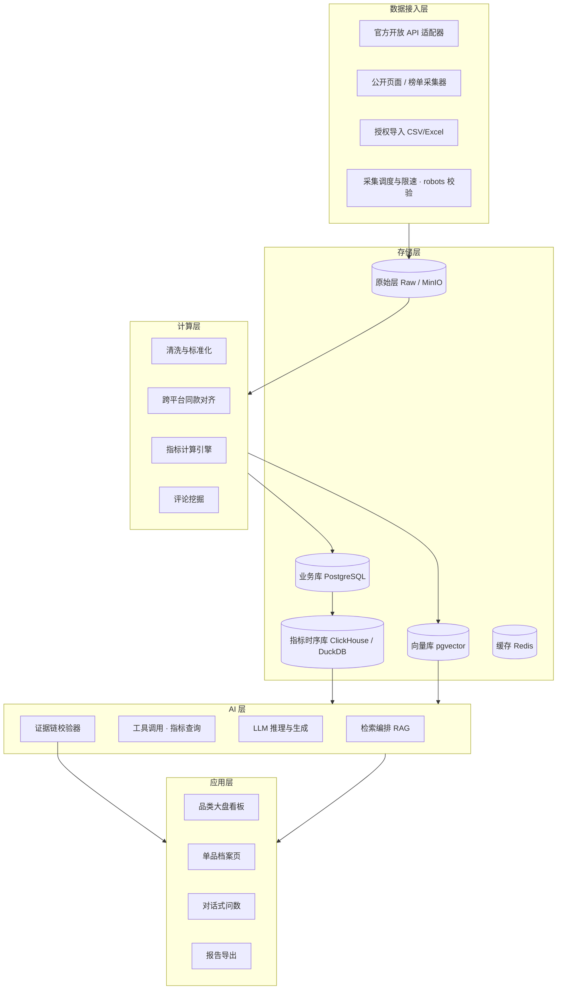

# 商情罗盘 MarketCompass — 项目设计说明

| 项目 | 内容 |
|---|---|
| 项目名称 | 商情罗盘（MarketCompass） |
| 副标题 | 面向中小电商的多源公开商情洞察与 AI 选品参谋 |
| 赛道 | AI 应用大赛 · 产业应用 · 数据分析 |
| 文档版本 | v1.0（已实现并验证） |
| 状态 | 全链路已实现：3 类数据源接入、指标引擎、AI 决策参谋（含自由追问与数字溯源）、看板与合规审计；63 项自动化测试通过 |

---

## 0. 文档目的

本文档定义「商情罗盘」的产品边界、功能模块、系统架构、数据与 AI 设计、合规基线，作为后续开发、分工与答辩材料的统一依据。

**范围界定**：本文档只做设计与骨架，不包含业务代码实现。所有采集行为限定为**公开数据的合规获取**（详见第 6 章）。

---

## 1. 项目概述

### 1.1 一句话定位

把散落在各电商平台的公开销量、价格、榜单、评价信息汇聚成结构化商情指标，再用「大模型 + 检索增强（RAG）+ 可解释证据链」输出选品、定价与竞争策略建议。

### 1.2 背景与痛点

| 现状 | 痛点 |
|---|---|
| 中小卖家选品靠经验、靠感觉 | 试错成本高，压货与滞销风险大 |
| 数据分散在各平台后台与公开页面 | 人工查数据耗时数小时，无法横向对比 |
| 现有数据工具只给"数字和图表" | 有数据没结论，看不懂"所以该怎么做" |
| 大模型直接问"卖什么好" | 缺数据支撑，答案空泛甚至编造 |

**核心矛盾**：数据可得性与决策可执行性之间存在断层。本项目补的正是这一段。

### 1.3 目标用户与典型场景

| 用户 | 典型场景 |
|---|---|
| 中小电商卖家 / 个体创业者 | "这个细分类目还值不值得进？进的话定什么价？" |
| 品牌市场部 / 选品团队 | "竞品近 8 周销量走势如何？我的价格带定位在哪？" |
| 投研 / 咨询分析师 | "输出一份某品类的市场机会简报，要带数据来源" |
| 代运营 / 电商服务商 | "批量评估 50 个候选品，给出优先级排序" |

### 1.4 差异化与创新点

1. **合规多源公开数据**：不走破解接口的灰产路线，用开放 API + 公开页面 + 授权导入，答辩经得起追问（详见第 6 章）。
2. **销量代理指标（Sales Proxy）体系**：公开数据拿不到平台真实销量，本项目用多信号融合 + 置信区间的方式给出**可校准的销量估计**，而不是假装拿到真值。
3. **证据链强制约束**：每一条 AI 建议都必须绑定 `指标值 + 数据来源 + 统计周期 + 置信度`，无证据不输出。
4. **数值与语言分离**：所有数字由 SQL/指标层计算后注入，大模型只负责解释与建议，从架构上抑制幻觉。
5. **从洞察到交付物**：一键生成《X 品类市场机会研究报告》（Word/PPT），直接可用。

### 1.5 合规基线（不可妥协项）

- 只采集**无需登录即可访问**的公开页面与平台官方开放接口数据；
- 遵守目标站点 `robots.txt`，设置限速与并发上限，不绕过验证码 / 签名 / 风控；
- 不采集任何个人信息（用户 ID、手机号、收货信息、头像昵称等），评论只做聚合情感与关键词统计，不留存原文身份信息；
- 平台数据仅用于聚合分析展示，不转售原始数据。

---

## 2. 功能设计

### 2.1 功能地图（总览）

| 编号 | 模块 | 核心职责 | 优先级 |
|---|---|---|---|
| F1 | 数据接入中心 | 合规多源采集、调度、监控 | P0 |
| F2 | 数据治理与商品对齐 | 清洗、跨平台同款识别、指标计算 | P0 |
| F3 | 商情分析引擎 | 趋势 / 价格带 / 竞争格局 / 评论挖掘 / 供需缺口 | P0（部分 P1） |
| F4 | AI 决策参谋 | RAG 检索、选品与定价建议、证据链 | P0 |
| F4b | 自由输入行情分析 | 任意商品名解析 → 行情数据罗列 → 分析报告 | P0（v0.1 已实现） |
| F5 | 可视化看板与交付 | 看板、对话问数、报告导出 | P0（看板）/ P1（问数、导出） |
| F6 | 系统管理 | 账号权限、配额、审计与合规台账 | P1 |

### 2.2 模块详述

#### F1 数据接入中心

| 子功能 | 说明 |
|---|---|
| 数据源注册 | 每个数据源登记：类型、接入方式、字段映射、合规声明、负责人 |
| 采集适配器 | 三个适配器：`openapi`（官方开放平台）、`public_page`（公开页面/榜单）、`import`（用户授权导入 CSV/Excel） |
| 调度与增量 | 定时任务（日/小时级）、断点续采、按商品维度增量更新 |
| 采集监控 | 成功率、延迟、字段缺失率、异常告警；限速与退避重试 |
| 原始层落湖 | 原始响应按 `源/日期/批次` 归档，保留可追溯性 |

#### F2 数据治理与商品对齐

| 子功能 | 说明 |
|---|---|
| 清洗标准化 | 单位统一（件/元）、时间对齐、异常值识别、缺失去重 |
| 跨平台同款识别 | 标题文本相似（SimHash + 向量）、关键属性匹配（品牌/规格/型号）、可选图像特征 |
| 统一类目体系 | 建立内部类目树，映射各平台类目，支撑跨平台对比 |
| 指标计算 | 见 4.3 指标定义，输出日粒度事实表 |
| 数据质量分 | 对每个商品记录数据完整度与可信度，向下游传递置信度 |

#### F3 商情分析引擎

| 子功能 | 说明 | 优先级 |
|---|---|---|
| 趋势与季节性 | 近 4/8/12 周销量代理指标走势、同比环比、季节因子 | P0 |
| 价格带分析 | 价格分布直方图、主流价格带、价格-销量弹性近似 | P0 |
| 竞争格局 | CR5、HHI、头部集中度、在售商品数与新品率 | P0 |
| 评论挖掘 | 情感倾向、痛点/卖点关键词、需求缺口词 | P1 |
| 供需缺口 | 需求热度 / 有效在售商品数，识别蓝海细分 | P1 |
| 竞品对比矩阵 | 多维雷达对比（价格、增速、评分、集中度） | P1 |

#### F4 AI 决策参谋（核心 AI 能力）

| 子功能 | 说明 |
|---|---|
| 知识库构建 | 行业报告、平台规则、品类知识切块入向量库 |
| 混合检索 | 向量检索 + 关键词检索 + 实时联网搜索 + 结构化指标查询（工具调用） |
| 选品建议 | 给定预算/类目/风险偏好，输出候选品清单与理由 |
| 定价建议 | 基于价格带与竞品给出建议区间与理由 |
| 风险提示 | 同质化、季节风险、退货/差评风险、合规风险 |
| 报告生成（Agent） | 多步任务：拉指标 → 检索 → 分析 → 成文 → 导出 |

#### F4b 自由输入行情分析（v0.1 已实现）

用户输入任意商品名（如「保温杯」「露营装备」「慕思家」），系统完成五步：

| 步骤 | 处理 | 实现位置 |
|---|---|---|
| 1 解析 | 词典（类目名 + 别名 + 品牌）+ 字符 bigram 相似度，输出匹配标的、匹配依据、匹配度、候选列表 | `services/analytics/market_analysis.resolve` |
| 2 取数 | 指标层罗列：规模、趋势、价格带、品牌份额、细分结构、评价痛点、增长/下滑榜、置信度分布 | `services/analytics/market_analysis.market_snapshot` |
| 3 生成 | 结论 + 建议动作 + 风险 + 局限性，每条动作绑定一个指标名 | `services/ai/advisor.analyze_market_query` |
| 4 校验 | 按指标名回指标层**重算**（含 `market.*`、`brand.share`、`product.sps`），逐条比对 | `services/ai/advisor.verify_evidence` |
| 5 降级 | 任一引用无法复现 → 拒绝输出结论，返回"数据不足" | 同上 |

**未覆盖策略**：匹配度低于 0.5 时明确返回"数据未覆盖"并给出最接近的候选，**不编造行情**。
品牌输入会自动落到该品牌的主销类目分析，并单独给出品牌份额作为对口指标。

#### F5 可视化看板与交付

- 品类大盘看板：热度榜、增速榜、蓝海榜；
- 单品档案页：销量代理指标曲线、价格带位置、竞品列表、AI 结论卡；
- 对话式问数（P1）：自然语言 → 语义层 → SQL → 图表 + 文字结论；
- 交付物导出（P1）：Word / PPT / Excel 报告。

#### F6 系统管理

- 账号与角色（管理员 / 分析师 / 只读）；
- 配额与限流（LLM token、采集请求数）；
- **合规审计台账**：每次采集记录来源 URL、时间、robots 判定结果、字段范围；
- 操作日志与数据血缘。

### 2.3 MVP 边界（先做什么）

**必做（P0）**：F1（2 个公开源）→ F2（清洗 + 指标）→ F3（趋势/价格带/竞争格局）→ F4（建议 + 证据链）→ F4b（自由输入行情分析）→ F5（看板）。

**可延后（P1）**：评论挖掘、对话问数、报告导出、权限体系。

**暂不做**：App 端、真实交易数据、付费数据源接入、跨平台自动投放。

---

## 3. 系统架构

### 3.1 总体架构



### 3.2 分层职责

| 层 | 职责 | 关键约束 |
|---|---|---|
| 接入层 | 多源合规取数 | 限速、robots、可追溯、无个人信息 |
| 存储层 | 分层存储（原始 / 明细 / 指标 / 向量） | 原始层不可变，指标层可重算 |
| 计算层 | 清洗、对齐、指标 | 幂等、可回溯、口径版本化 |
| AI 层 | 检索、推理、证据链校验 | 数值来自指标层，模型不造数 |
| 应用层 | 看板、问数、报告 | 每个结论可下钻到数据 |

### 3.3 关键数据流（日批 + 按需）

```
定时调度 → 采集公开数据 → 原始层归档
        → 清洗标准化 → 商品对齐 → 指标计算（日粒度）
        → 指标入库 + 知识/评论入向量库
        → 用户提问 → 检索编排（指标查询 + 向量检索 + 联网搜索）
        → LLM 生成建议 → 证据链校验（无证据则拒绝输出）
        → 看板 / 报告
```

### 3.4 技术栈选型

| 层次 | 选型 | 选型理由 |
|---|---|---|
| 后端 API | Python 3.11 + FastAPI + Pydantic | 生态与 AI 工具链一致，类型友好 |
| 采集 | httpx + Playwright（仅公开页）+ APScheduler/Celery | 静态页用 httpx，动态公开页用浏览器渲染 |
| 数据处理 | Polars / Pandas | 单机可跑，比赛部署成本低 |
| 业务库 | PostgreSQL 16 | 事务、JSON 支持好 |
| 指标库 | ClickHouse（或 DuckDB 起步） | 时序聚合快，DuckDB 可零运维起步 |
| 向量库 | pgvector | 与 PG 同实例，减少组件 |
| 缓存 / 队列 | Redis | 限速计数、任务队列 |
| LLM 编排 | LangChain / LlamaIndex + 自研编排 | 快速搭 RAG，关键链路自控 |
| 模型 | 通用 LLM API + Embedding + Reranker | 按成本/效果可替换 |
| 前端 | React + TypeScript + Vite + ECharts | 图表丰富，开发快 |
| 部署 | Docker Compose（可选 K8s） | 一键复现，便于评审 |
| 可观测 | Prometheus + Grafana + Langfuse | 系统指标 + LLM 调用观测 |

### 3.5 部署形态

- 开发/演示：单机 Docker Compose（api + web + postgres + redis + duckdb/clickhouse）；
- 生产演进：采集与分析服务拆分，指标库独立，AI 层可横向扩展。

### 3.6 v0.1 实现说明（零依赖跑通版）

首个可运行版本为规避环境与网络限制（无外网、无法 pip 安装），采用**零第三方依赖**实现。
架构分层与上文完全一致，仅替换具体组件，接口契约保持不变：

| 设计选型 | v0.1 实现 | 迁移路径 |
|---|---|---|
| FastAPI | Python 标准库 `http.server` | 路由逻辑不变，可平滑迁移到 FastAPI |
| PostgreSQL + ClickHouse | SQLite 单文件 | 建表 SQL 基本兼容，指标查询可平移 |
| React + Vite + ECharts | 原生 HTML/CSS/JS + Canvas 绘图 | 看板 API 契约不变，前端可整体替换 |
| pgvector 向量库 | 内置知识条目 + 关键词匹配 | 接入向量库后替换 `retrieve_knowledge` |
| Docker Compose | 两条脚本命令 | 后续容器化 |

目的：让评审与开发在**无网络、无依赖安装**的环境中一键复现完整链路。

---

## 4. 数据设计

### 4.1 数据源清单（合规）

| 类别 | 示例 | 接入方式 | 风险 |
|---|---|---|---|
| 平台开放 API | 各电商开放平台商品/类目接口 | 官方授权 + 签名 | 低 |
| 第三方合规数据服务 | 生意参谋类、内容电商数据平台 | 采购/授权 API | 低（成本） |
| 公开页面 | 商品公开详情页、公开榜单、公开搜索指数页 | HTTP/浏览器采集 | 中（需限速与 robots 校验） |
| 用户授权导入 | 商家自有后台导出报表 | 文件上传 | 无 |
| 公开知识 | 行业报告、平台规则公告 | 人工/半自动入库 | 低 |

> 每个数据源必须在 F6 中登记合规声明，采集行为写入审计台账。
>
> **实测结论（2026-10-15）**：苏宁易购公开搜索页已接入（`services/collector/suning_search.py`），
> 可稳定解析 SKU / 标题 / 卖点 / 评价数 / 店铺类型 / 榜单排名；价格因异步加载不可得。
> 淘宝与唯品会的 robots.txt 明确 `Disallow: /*?*`（搜索页被禁止），**不采集**；
> 京东与当当的 `/robots.txt` 被替换成首页 HTML —— `robotparser` 解析失败时会默认放行，
> 直接采信会把违规抓取误判成合规，故 **不采集**。

### 4.2 跨平台同款识别策略

1. **粗筛**：品牌 + 关键规格（容量/型号/尺寸）+ 类目一致；
2. **精排**：标题向量相似度 + 属性字段匹配得分；
3. **判定**：得分 > 阈值自动合并，中间区间转人工确认队列；
4. **可解释**：记录匹配依据，允许人工拆分。

### 4.3 核心指标定义

| 指标 | 定义 | 说明 |
|---|---|---|
| 销量代理指标 SPS | `w1·Δ公开已售件数 + w2·(评价增量 / 类目评论转化率) + w3·榜单分位反推量级` | 权重 w1=0.58、w2=0.24、w3=0.18（v0.1 固定权重，后续用历史数据回归校准），输出**区间 + 置信度**而非单点 |
| 销售额估计 GMS | `SPS × 期间均价` | 附置信区间 |
| 价格带分布 | 按价格分桶的 SPS 占比 | 识别主流价格带 |
| 集中度 CR5 | Top5 商品 SPS 占比 | 越高越难切入 |
| HHI | 各商品 SPS 份额平方和 | 竞争结构量化 |
| 增长动能 | 近 4 周 SPS 环比 | 识别上升期类目 |
| 需求热度 | 公开搜索指数 / 内容平台讨论量 | 需求侧信号 |
| 供需缺口 | `需求热度 / 有效在售商品数` | 高值 = 潜在蓝海 |
| 数据置信度 | 由数据完整度、源可信度、样本量加权 | 全链路传递，进入 AI 证据链 |

### 4.4 数据模型（核心表）

```
-- 维度
dim_platform(platform_id, name, source_type, compliance_note)
dim_category(category_id, parent_id, name, platform, platform_category_id)
dim_product(product_id, platform_id, title, brand, category_id, attrs_json, url, first_seen)
dim_product_cluster(cluster_id, canonical_title, category_id)   -- 跨平台同款簇
dim_product_cluster_map(cluster_id, product_id, match_score, match_reason)
dim_keyword(keyword_id, text, category_id, source)

-- 事实
fact_price_daily(product_id, stat_date, price, promo_price, currency)
fact_sales_proxy_daily(product_id, stat_date, sps_low, sps_mid, sps_high, confidence, evidence_json)
fact_rank_daily(product_id, stat_date, list_name, rank, list_size)
fact_review_agg(product_id, stat_date, review_cnt, sentiment_pos, sentiment_neg, top_keywords_json)
fact_search_heat(keyword_id, stat_date, heat_index, source)

-- 交付与 AI
ai_report(report_id, user_id, topic, params_json, content_md, created_at)
ai_claim(claim_id, report_id, claim_text, metric, value, period, source_ref, confidence)
audit_collect_log(log_id, source, url, fetched_at, robots_allowed, fields, batch_id)
```

---

## 5. AI 能力设计

### 5.1 检索编排（RAG + 工具调用）

```
用户问题
  → 意图解析（选品 / 定价 / 竞品 / 趋势）
  → 并行取数：
       ① 指标查询工具（SQL → 指标层，得到确定数值）
       ② 向量检索（行业知识、平台规则）
       ③ 联网搜索（政策、舆情、时效信息）
  → 重排（Rerank）取 Top-K 证据
  → LLM 生成（严格模板 + JSON 输出）
  → 证据链校验器（引用存在？数值一致？覆盖充分？）
  → 通过则展示，不通过则降级为"数据不足"
```

### 5.2 输出规范（强制结构化）

```json
{
  "summary": "一句话结论",
  "conclusion": "详细判断",
  "evidence": [
    {"metric": "CR5", "value": 0.78, "period": "2025-W40~W43",
     "source": "public_page:平台榜单A", "confidence": 0.72}
  ],
  "actions": [
    {"step": "切入 39-59 元价格带", "reason": "该带 SPS 占比 41% 且集中度低于类目均值"}
  ],
  "risks": ["头部集中度偏高，新品冷启动成本高"],
  "confidence": 0.68,
  "limitations": ["样本仅覆盖 2 个公开源，销量为代理估计"]
}
```

### 5.3 数值与语言分离原则

- 所有数字**只能**来自指标层查询结果，禁止模型在文本中自行推算；
- 提示词注入的指标结果带 `metric_id`，生成后由校验器逐条比对；
- 不符即拦截重生成，连续失败则输出"数据不足，无法给出建议"。

### 5.4 评测方案

| 指标 | 方法 |
|---|---|
| 引用准确率 | 抽样 100 条 claim，人工核对来源与数值 |
| 事实一致性 | 数值与指标层比对，自动校验通过率 |
| 建议可执行性 | 由 3 名电商从业者 1-5 分盲评 |
| 幻觉率 | 无来源陈述占比 |
| 端到端延迟 / 成本 | 单次问答耗时与 token 成本 |

---

## 6. 合规与安全设计

| 维度 | 措施 |
|---|---|
| 采集合规 | 仅公开数据、robots 校验、限速退避、无登录态、不绕风控 |
| 个人信息 | 不采集；评论仅聚合统计；敏感字段落库前脱敏 |
| 数据使用 | 仅聚合分析展示，不转售原始数据；页面标注数据来源与统计口径 |
| 审计 | 每次采集写 `audit_collect_log`，可回答"这条数据哪来的" |
| 模型安全 | 输入输出过滤、提示注入防护、报告标注 AI 生成与局限性 |
| 知识产权 | 知识库仅存公开报告摘要 + 出处，不做全文复制 |

> 答辩时**主动**展示第 6 章，把"数据从哪来"从风险点变成加分项。

---

## 7. 非功能需求

| 类别 | 目标 |
|---|---|
| 性能 | 看板接口 P95 < 500ms；单次 AI 问答 < 15s |
| 规模 | 支持 10 万商品、千万级日指标（DuckDB/ClickHouse） |
| 可用性 | 采集失败不影响查询；指标层可全量重算 |
| 成本 | LLM 调用缓存 + 指标预计算，单次问答成本可控 |
| 可复现 | Docker Compose 一键起，种子数据 + 演示脚本 |
| 可扩展 | 新增数据源只需实现适配器接口 |

---

## 8. 代码目录结构（规划）

```
market-compass/
├── README.md
├── docs/
│   ├── 01-project-design.md        # 本文档
│   ├── 02-data-sources.md          # 数据源台账与合规声明
│   └── 03-metrics-spec.md          # 指标口径规范
├── apps/
│   ├── api/                        # FastAPI 服务
│   └── web/                        # React 前端
├── services/
│   ├── collector/                  # F1 采集（适配器 + 调度）
│   ├── etl/                        # F2 清洗 / 对齐 / 指标
│   └── ai/                         # F4 RAG / Agent / 校验器
├── packages/
│   └── schemas/                    # 共享数据模型与契约
├── infra/
│   ├── docker/                     # compose 与镜像
│   └── sql/                        # 建表与迁移
├── data/
│   ├── raw/  interim/  processed/  # 分层数据（不入库）
│   └── seed/                       # 演示种子数据
└── tests/
```

---

## 9. 里程碑（8 周参考）

| 周次 | 目标 | 交付 |
|---|---|---|
| W1 | 数据源确认 + 合规台账 | 02-data-sources.md |
| W2 | 骨架搭建 + 采集适配器 | 可跑通 1 个公开源 |
| W3 | 清洗 + 商品对齐 | 明细层数据 |
| W4 | 指标计算引擎 | 03-metrics-spec.md + 指标表 |
| W5 | 看板（大盘 + 单品档案） | 前端可演示 |
| W6 | RAG 建议 + 证据链校验 | AI 问答可用 |
| W7 | 报告导出 + 评测 | 评测报告 |
| W8 | 答辩材料打磨 | 演示脚本 + PPT + 演示数据 |

---

## 10. 风险与对策

| 风险 | 影响 | 对策 |
|---|---|---|
| 公开数据字段有限，销量不可得 | 指标可信度受质疑 | 明确代理指标口径 + 置信区间 + 局限性声明 |
| 目标站点反爬 / 页面改版 | 采集中断 | 多源冗余 + 监控告警 + 授权导入兜底 |
| 合规被质疑 | 答辩失分 | 审计台账 + 合规声明页 + 只用公开数据 |
| LLM 幻觉 | 建议不可信 | 数值与语言分离 + 证据链强制校验 |
| 比赛周期紧 | 功能做不完 | 严守 MVP 边界，P1 只做加分项 |

---

## 11. 待决事项

1. 首批接入哪 2 个公开数据源？（建议：1 个公开榜单页 + 1 个官方开放 API 沙箱）
2. 指标库起步用 DuckDB 还是直接上 ClickHouse？
3. 是否引入图像特征做同款识别？（成本 vs 准确率）
4. 演示用真实品类选哪个？（建议选数据丰富、季节性弱的类目，如家居收纳）
